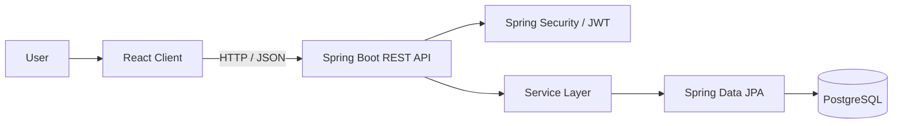

# Axlero — Dynamic Data Dashboard Builder

**Turn business data into clear, interactive insights.**

Axlero is a web-based dashboard builder developed by the **RecursionDev** team. The repository contains a React client and a Spring Boot REST API backed by PostgreSQL. Its goal is to help users organize workspaces and dashboards, work with datasets, explore metrics, and present information visually.

> **Project status:** Active development. The repository is evolving, so feature availability and setup details may change as modules are completed and integrated. The pages and modules listed below describe the current project structure; they should not be read as a claim that every workflow is production-ready.

## At a glance

| Area | Technology |
|---|---|
| Frontend | React 18, React Router, Axios |
| Charts | Recharts |
| Data handling | PapaParse |
| Frontend tooling | Webpack 5, Babel |
| Backend | Java 17, Spring Boot 3.5.x |
| API | Spring Web (REST) |
| Persistence | Spring Data JPA, Hibernate |
| Database | PostgreSQL |
| Security | Spring Security, JSON Web Token (JJWT) |
| Build | Maven |
| Collaboration | Git and GitHub |

## Project areas

The current client source is organized around these application areas:

- **Authentication** — sign-in and account access screens.
- **Workspaces** — workspace management screens.
- **Dashboards** — dashboard listing and overview screens.
- **Dashboard builder** — the builder interface for configuring dashboard content.
- **Datasets** — dataset management screens and CSV parsing support.
- **Metrics** — metrics-focused interface and charting support.
- **Settings and navigation** — shared application navigation and settings screens.

The backend follows a layered Spring application structure with configuration, controllers, DTOs, entities, repositories, security, services, and exception handling.

## Architecture



The client development server is configured to proxy `/api` requests to the backend at `http://localhost:8080`.

## Repository structure

```text
dynamic-data-dashboard/
├── backend/
│   ├── pom.xml
│   └── src/
│       └── main/
│           ├── java/com/recursiondev/dashboard/
│           │   ├── config/
│           │   ├── controller/
│           │   ├── dto/
│           │   ├── entity/
│           │   ├── enums/
│           │   ├── exception/
│           │   ├── repository/
│           │   ├── security/
│           │   └── service/
│           └── resources/
│               └── application.yml
├── client/
│   ├── package.json
│   ├── webpack.config.js
│   └── src/
│       ├── components/
│       ├── context/
│       ├── pages/
│       ├── services/
│       ├── App.jsx
│       └── main.jsx
└── README.md
```

## Getting started

### Prerequisites

Install the following before running the project:

- Java 17
- Maven
- Node.js and npm
- PostgreSQL
- Git

### 1. Clone the repository

```bash
git clone https://github.com/RecursionDev/dynamic-data-dashboard.git
cd dynamic-data-dashboard
```

### 2. Configure PostgreSQL

Create the database used by the backend:

```sql
CREATE DATABASE dashboard_db;
```

The backend configuration uses the PostgreSQL user `postgres` and reads the database password from the `DB_PASSWORD` environment variable. Set that variable in your terminal or IDE run configuration before starting the backend.

**Do not commit database passwords, JWT secrets, or other credentials to GitHub.**

### 3. Start the backend

From the repository root:

```bash
cd backend
mvn spring-boot:run
```

The Spring Boot API is configured to run at:

```text
http://localhost:8080
```

### 4. Start the frontend

Open a second terminal from the repository root:

```bash
cd client
npm install
npm start
```

The Webpack development server is configured for:

```text
http://localhost:3000
```

The client development server proxies requests beginning with `/api` to the backend on port `8080`.

## Development workflow

The team uses a branch-based Git workflow:

| Branch | Purpose |
|---|---|
| `main` | Stable, reviewed code |
| `develop` | Shared integration branch |
| `feature/<task-name>` | Individual feature or fix |

Recommended contribution flow:

1. Pick or create a GitHub Issue describing the task.
2. Update your local `develop` branch.
3. Create a focused feature branch from `develop`.
4. Commit work with clear messages and push the feature branch.
5. Open a Pull Request targeting `develop`.
6. Request review, address feedback, and ensure relevant checks pass.
7. Merge to `develop` only after review; release reviewed changes from `develop` to `main`.

Before switching branches, commit or stash local changes. Do not force-push shared branches or merge branches with unresolved conflicts.

## Team contributions

The project is being developed by a six-member team. The current responsibility split is:

| Team role | Main responsibility |
|---|---|
| Member 1 | Backend integration, code review, build coordination, testing and release |
| Member 2 | Backend authentication and security |
| Member 3 | Backend workspace and dashboard APIs |
| Member 4 | Backend widgets, datasets, query/metrics and related API work |
| Member 5 | Frontend application shell, authentication and core screens |
| Member 6 | Frontend dashboard experience, visualizations and API integration |

Replace the member labels with the contributors' GitHub usernames and refine responsibilities to match the work actually merged. GitHub's Contributors panel is generated from commit history; use commits authored with each member's linked GitHub identity and merged into the default branch so contributions can be attributed correctly.

## Screenshots and demo

Add current application screenshots to a folder such as `docs/screenshots/` and embed them here once the team has captured the latest working UI.

Suggested screenshots:

- Authentication screen
- Workspace view
- Dashboard overview
- Dashboard builder
- Dataset management
- Metrics and visualizations

Only include screenshots of features that are currently working in the shared project.

## Testing and quality

Before opening or approving a Pull Request:

- Build the backend with `mvn test`.
- Build the frontend with `npm run build`.
- Test the affected user flow locally.
- Check API errors, validation, loading and empty states where relevant.
- Never commit secrets, local environment files, build output, or dependency folders.

## Roadmap

Planned work should be tracked through GitHub Issues and the project board. Update this section as priorities are agreed by the team; do not mark a planned feature as complete until it has been implemented, reviewed, and tested.

## Contributing

Contributions from the RecursionDev team should follow the issue and Pull Request workflow above. Keep Pull Requests focused, describe the reason for the change, list how it was tested, and link the related issue.

---

<p align="center">
  <strong>AXLERO — Turning Data into Decisions.</strong><br/>
  <sub>Build. Analyze. Visualize. Innovate.</sub>
</p>
